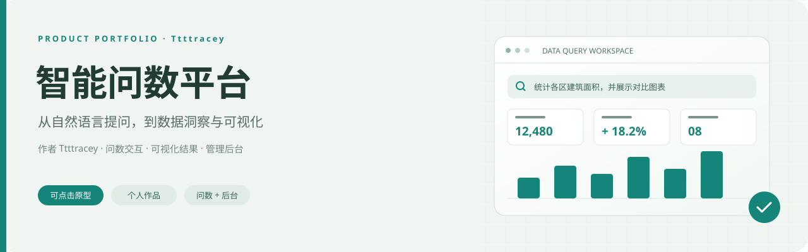
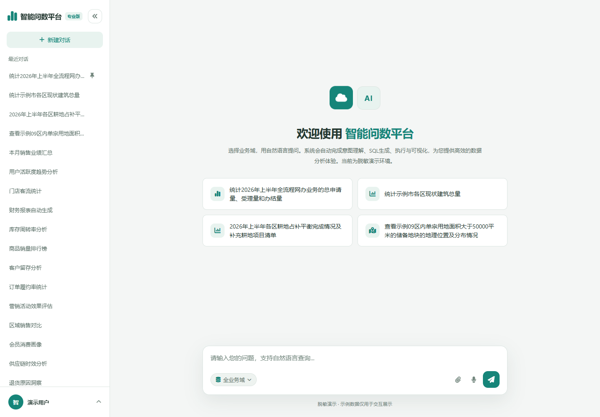
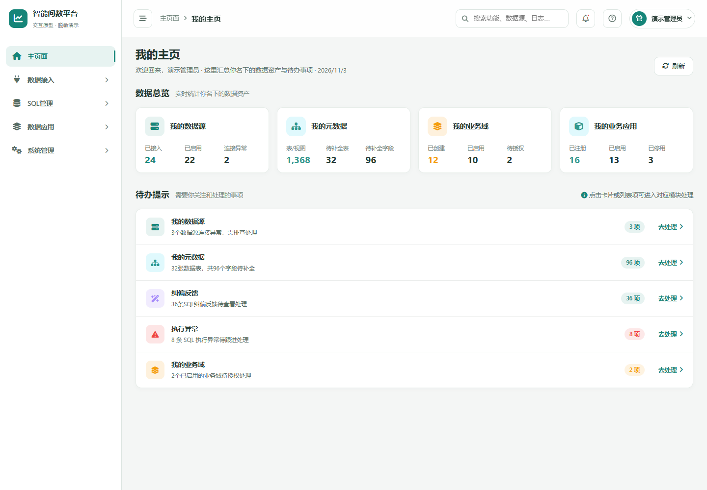

<p align="center">
  
</p>

<p align="center">
  <strong>我的产品设计作品 · 智能问数平台</strong><br>
  从自然语言提问到可视化结果，从用户查询到后台管理，呈现我完成的产品交互原型。
</p>

<p align="center">
  作者：<a href="https://github.com/Ttttracey"><strong>Ttttracey</strong></a> · 产品交互原型 · 求职作品展示
</p>

<p align="center">
  <a href="https://ttttracey.github.io/intelligent-data-query-platform/qa.html"><strong>体验智能问数 ↗</strong></a> ·
  <a href="https://ttttracey.github.io/intelligent-data-query-platform/"><strong>体验管理后台 ↗</strong></a>
</p>

<p align="center">
  <a href="#overview">项目定位</a> ·
  <a href="#contribution">我的工作</a> ·
  <a href="#design">关键设计</a> ·
  <a href="#preview">作品预览</a> ·
  <a href="#journey">体验路径</a>
</p>

---

<a id="overview"></a>
## 项目定位

业务人员希望直接获得数据答案，但实际查询往往涉及寻找数据来源、明确指标口径、描述筛选条件和选择图表。本作品围绕这一场景，用可点击的交互原型呈现自然语言问数产品的核心流程。

我完成的原型包含两个相互配套的界面：**智能问数端**面向查询与分析，**管理后台**面向数据资产与问数配置管理。通过这两部分，展示用户操作、分析反馈与后台配置之间的产品关系。

**作品形式：可点击交互原型。** 本仓库重点展示我的页面组织、流程表达和交互设计成果。

<a id="contribution"></a>
## 我的工作

| 工作内容 | 在作品中的具体呈现 |
| :--- | :--- |
| **问数端原型设计** | 组织业务域选择、示例问题、提问输入、历史对话和结果展示等核心页面元素 |
| **问答流程与状态表达** | 串联提问、补充条件、分析过程、答复结果与连续追问，并设置对应的状态反馈 |
| **分析结果交互设计** | 通过统计表、图表、地图和结果操作入口，呈现不同分析任务的结果形态 |
| **后台页面与导航设计** | 组织数据源、元数据、SQL 样例、业务域、模型、权限和日志等功能模块 |
| **可点击原型交付** | 将页面、操作与状态变化串联成可在浏览器中体验的原型，便于讲解方案和检查流程 |

这份作品希望呈现的不只是页面效果，也包括：**如何组织复杂功能、如何让用户明确下一步操作，以及如何表达系统处理过程与结果。**

<a id="design"></a>
## 关键设计

### 01 · 用示例问题承接首次使用

问数首页同时提供提问输入框与业务示例。用户可以直接描述需求，也可以先点击示例了解产品支持的查询方式。业务域选择用于明确提问范围，历史对话用于承接后续使用。

### 02 · 为不完整的问题提供补充入口

当问题缺少区域、主题或分析方式时，使用可点击的补充选项引导用户完善条件，并将补充信息带回提问流程。通过这一设计，呈现从模糊输入到明确查询目标的交互路径。

### 03 · 将分析过程与最终结果分层展示

把意图理解、问题拆解、SQL 生成与执行等过程组织为可展开查看的步骤，最终结果则以文字、统计表、图表或地图呈现。用户可以优先查看结论，也可以按需了解处理过程。

### 04 · 用后台结构承接问数产品的管理需求

后台围绕数据接入、SQL 管理、数据应用与系统管理组织导航。首页集中展示数据资产与待办事项，让管理者从总览进入具体配置、异常处理和反馈页面。

<a id="preview"></a>
## 作品预览

### 智能问数 · 用户查询视角

业务域选择、示例提问、历史对话与输入操作构成核心使用入口。



### 管理后台 · 数据管理视角

数据资产概览与待办事项承接管理任务，通过模块导航进入具体功能。



<a id="journey"></a>
## 推荐体验路径

| 步骤 | 操作 | 建议关注的设计 |
| :--- | :--- | :--- |
| **1 · 从问题开始** | 打开 [智能问数端](https://ttttracey.github.io/intelligent-data-query-platform/qa.html)，点击首页示例问题 | 首次使用引导、业务域选择和提问入口 |
| **2 · 查看过程与结果** | 查看分析步骤与答复，再浏览对应图表或地图 | 过程与结论的层级、结果表达和操作入口 |
| **3 · 补充查询条件** | 输入一个条件不完整的问题，查看补充选项 | 模糊输入如何被引导为明确需求 |
| **4 · 进入管理视角** | 打开 [管理后台](https://ttttracey.github.io/intelligent-data-query-platform/)，点击登录进入 | 信息架构、数据资产组织和管理任务入口 |

建议先使用预置问题体验完整路径，再尝试自由输入。原型通过内置示例逻辑呈现问答与分析过程。

<details>
<summary><strong>本地查看与项目结构</strong></summary>

1. 点击仓库上方 **Code → Download ZIP**，下载并解压。
2. 打开 `qa.html` 体验智能问数，或打开 `index.html` 体验管理后台。
3. 后台点击登录即可进入。首次打开需要联网加载公开的前端组件。

```text
intelligent-data-query-platform/
├── index.html               管理后台原型
├── app.js                   后台导航、页面渲染与交互
├── qa.html                  智能问数原型
├── assets/readme/           作品封面与页面预览
├── .nojekyll                静态页面发布配置
└── README.md                作品介绍
```

请保持 `index.html` 与 `app.js` 位于同一目录。页面由 HTML、CSS 与 JavaScript 构成，使用 Font Awesome、Chart.js、ECharts、SheetJS 与 Leaflet 等前端组件。

</details>

---

更多作品：[PM Skills](https://github.com/Ttttracey/PM_skills) · 我的产品需求、文档与原型工作流
